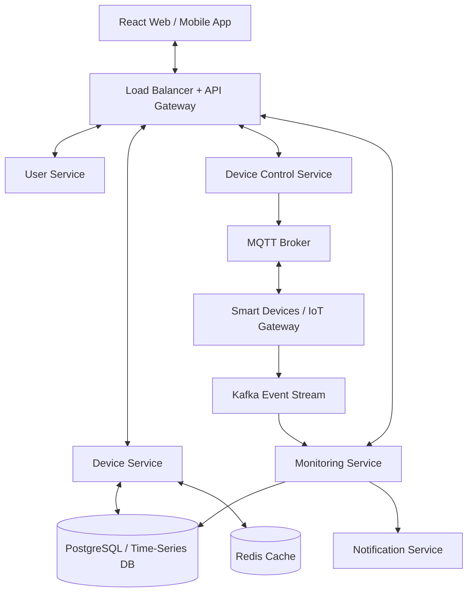
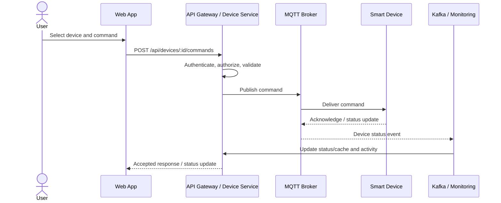

# Haven — Smart Home Device Management Platform

A full-stack smart-home device management demo created for a High-Level Design (HLD) challenge. The app includes a responsive dashboard, device registration/removal, device commands, status monitoring, activity logs, REST APIs, and an architecture page explaining how the platform can scale.

> **Demo note:** The current backend uses an in-memory store and simulates device commands. MQTT, Kafka, Redis, PostgreSQL, and a time-series database are documented as production architecture components, not provisioned by this demo.

## Features

- Dashboard metrics: total, online, offline, active devices and estimated active load.
- Device search and filters by status/type.
- Register and remove devices.
- Send commands to online devices; offline devices return an error.
- Activity log and device status endpoint.
- Architecture page covering API gateway, microservices, messaging, data stores, caching, security, resilience, and scaling.
- Responsive UI for desktop and mobile.

## Tech stack

- Frontend: React, Vite, Lucide icons, CSS
- Backend: Node.js, Express, REST/JSON
- Production design: PostgreSQL, MongoDB (optional for flexible device configuration), Redis, MQTT, Kafka, time-series database, load balancer/API gateway

## Requirements

Node.js 18+ and npm.

## Run locally

From the project root:

```bash
npm run install:all
npm run dev
```

Open the Vite URL printed in your terminal (usually `http://localhost:5173`). The API runs at `http://localhost:4000`.

You can run the services separately:

```bash
npm --prefix backend install
npm --prefix frontend install
npm --prefix backend run dev
npm --prefix frontend run dev
```

## REST API reference

| Method | Endpoint | Description | Success |
|---|---|---|---|
| `GET` | `/api/health` | Health check | `200 OK` |
| `GET` | `/api/metrics` | Dashboard metrics | `200 OK` |
| `GET` | `/api/devices` | List/search devices (`?q=`) | `200 OK` |
| `POST` | `/api/devices` | Register device | `201 Created` |
| `GET` | `/api/devices/:id/status` | Get current status | `200 OK` |
| `POST` | `/api/devices/:id/commands` | Send device command | `202 Accepted` |
| `GET` | `/api/devices/:id/activity` | Device activity | `200 OK` |
| `GET` | `/api/activity` | Recent activity | `200 OK` |
| `DELETE` | `/api/devices/:id` | Remove device | `204 No Content` |

### Example: control a device

```bash
curl -X POST http://localhost:4000/api/devices/D-1001/commands \
  -H 'Content-Type: application/json' \
  -d '{"command":"TURN_OFF"}'
```

Allowed demo commands: `TURN_ON`, `TURN_OFF`, `LOCK`, `UNLOCK`, `ACTIVATE`, `DEACTIVATE`. A command to an offline device returns `503 Service Unavailable`; unknown devices return `404 Not Found`.

## High-Level Design



### Design decisions

1. **API Gateway + HTTPS:** Central request routing, authentication, authorization, rate limiting and TLS.
2. **Microservices:** User, device, command, monitoring and notification responsibilities can be deployed and scaled independently.
3. **Databases:** PostgreSQL for users, ownership and device metadata; a time-series store for high-volume telemetry; optional MongoDB for flexible per-device configuration.
4. **Caching:** Redis cache-aside for hot device status and frequently accessed user-device lists. Invalidate/update cache on status events; use TTL as a safety net.
5. **Messaging:** MQTT for lightweight device communication; Kafka for durable, high-throughput event streams and multiple consumers. Use acknowledgements, retries, idempotency keys and dead-letter queues.
6. **Scalability:** Stateless services behind load balancers, autoscaling, partitioned/sharded device records, partitioned telemetry, queue-based backpressure and regional device gateways.
7. **Reliability:** Timeouts, bounded retries with backoff, circuit breakers, health checks, replicated durable stores and observability.
8. **Security:** TLS, unique device credentials/certificates, OAuth/JWT for users, role-based access, command authorization, audit logs and secret management.

## Sequence: control a device



## GitHub publishing

This project is published to [Sivasathya07/Smarthome](https://github.com/Sivasathya07/Smarthome).
To publish updates, run these commands from the project root:

```bash
git add .
git commit -m "Describe your changes"
git push
```

## Future improvements

- Persist device data in PostgreSQL.
- Add user login and role-based authorization.
- Connect a real MQTT broker and simulate device acknowledgements.
- Add Redis caching and Kafka consumers via Docker Compose.
- Add automated API tests and deployment configuration.
